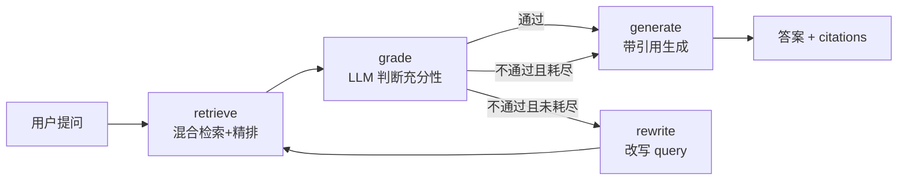

# Enterprise Knowledge Base v2

一个本地可运行的企业知识库 Agentic RAG 系统：**BM25 + 向量混合检索 → CrossEncoder 精排 → LLM 生成 → grade/rewrite 自纠正循环**，支持 Chroma 持久化、增量入库、检索降级、引用溯源与 RAGAS 评估。

> 定位：v2 在 v1 的检索管道上叠加 LangGraph 状态图，实现「检索不足 → 改写重试 → 耗尽兜底」的 Agent 循环。生产化能力（查询路由、父子索引、异步服务化）见 [Roadmap](#roadmap)。

---

## ✨ 特性

- **混合检索**：BM25（关键词）+ BGE-M3 向量（语义），`EnsembleRetriever` 融合，权重可配
- **CrossEncoder 精排**：`BAAI/bge-reranker-v2-m3` 对混合召回结果重排序，`top_n=3`
- **检索降级**：精排空结果 / 精排异常时自动退回混合检索，链路不中断
- **增量入库**：基于内容 MD5 指纹去重，重复导入幂等
- **Chroma 持久化**：本地落盘，重启不丢索引
- **空检索兜底**：无检索结果时不调用 LLM，避免幻觉
- **分层调试**：`DEBUG` 开关可打印 BM25 / 向量 / 混合 / 精排四层召回结果；Agent 图每轮打印检索、grade 判定、重写 query
- **Agent 循环**：LangGraph 状态图 `retrieve → grade → rewrite/generate`，检索不足时自动改写 query 重试，最多 2 次，避免死循环
- **grade 稳定性**：grade 节点使用 `temperature=0` 独立 LLM + 存在性判断 prompt，三次重复运行判定一致
- **引用溯源**：答案带 `[编号]`，`citations` 字段返回 `doc_id` 和原文片段，可人工核验
- **RAGAS 评估**：`eval/ragas_eval.py` 跑 faithfulness / context_precision / answer_relevancy 三项指标

---

## 🏗 架构



**检索分层**：BM25 负责专有名词与关键词精确匹配（如 `Art_1062`），向量负责语义匹配（如「持久化」→ `SqliteSaver`），精排负责在候选池里挑出最相关的 3 条送进 LLM。
**v2 相比 v1 的变化**：v1 是线性管道（检索 → 精排 → 生成），检索不足时只能拒答。v2 在检索和生成之间插入 `grade` 判定和 `rewrite` 重试，形成闭环。`grade` 用 LLM 判断「这批文档够不够回答」，不够就改写 query 再检索，最多 2 次，耗尽后强制生成。

---

## 🚀 快速开始

### 1. 环境要求

- Python 3.10+
- 可访问外网（首次运行会下载 `bge-m3` 嵌入与 `bge-reranker-v2-m3` 精排模型）

### 2. 安装依赖

```bash
pip install langchain-chroma chromadb langchain-openai langchain-community \
            langchain-classic rank_bm25 sentence-transformers python-dotenv \
	    langgraph ragas datasets
```

> `langchain-classic` 提供 `EnsembleRetriever`、`ContextualCompressionRetriever`、`CrossEncoderReranker` 等检索组件。若你的环境中这些模块位于其他包名下，按实际导入路径调整即可。

### 3. 配置环境变量

在项目**父目录**创建 `.env`（代码中按 `../.env` 加载）：

```dotenv
DEEPSEEK_API_KEY=sk-xxxxxxxxxxxxxxxx
SILICONFLOW_API_KEY=sk-xxxxxxxxxxxxxxxx
```

| 变量 | 用途 | 获取方式 |
|---|---|---|
| `DEEPSEEK_API_KEY` | LLM 生成（`deepseek-chat`） | [DeepSeek 开放平台](https://platform.deepseek.com/) |
| `SILICONFLOW_API_KEY` | Embedding（`BAAI/bge-m3`） | [SiliconFlow](https://siliconflow.cn/) |

> 代码中已设置 `HF_ENDPOINT=https://hf-mirror.com` 加速 HuggingFace 模型下载，国内网络环境下无需额外配置。

### 4. 运行

```bash
python enterprise_kb_v1.py			# v1 管道

python agentic_rag_graph.py		# v2 Agent图

python eval/ragas_eval.py			# RAGAS 评估
```

v1首次运行会：
1. 初始化 Chroma（`./enterprise_kb_db`）
2. 对 6 条样本文档切分并入库
3. 执行两组测试问答
再次运行同一批数据会显示 `🔄 数据无变化，跳过入库。`

v2首次运行会额外加载 LangGraph 图并执行 Agent 循环，日志会显示每轮的检索、grade 判定和重写 query。

---

## 📁 项目结构

```
.
├── enterprise_kb_v1.py        # v1 管道：初始化 → 入库 → 检索 → 生成
├── agentic_rag_graph.py     # v2 Agent 图：retrieve → grade → rewrite/generate
├── rag_utils.py                      # 工具：文档指纹、清洗与切分
├── tools/
│      └── knowledge_tool.py        # 预留：知识库检索 Tool，供 v3 多工具路由使用
├── eval/
│	└── ragas_eval.py           # RAGAS 端到端评估
	└── BASELINE.md              # 评估基线（v3 修改完善，当前为v2稳定性验证统计）
├── enterprise_kb_db/          # Chroma 持久化目录（运行后生成）
└── .gitignore
└── requirements.txt
└── README.md
```

**`rag_utils.py`**

| 函数 | 作用 |
|---|---|
| `generate_doc_id(content)` | 基于内容 MD5 生成文档唯一指纹，用于增量去重 |
| `clean_and_split_documents(docs)` | 统一 metadata（`source_system`、`author`）+ 中文优化递归切分（512/50） |

**`agentic_rag_graph.py`**

| 节点 | 作用 |
|---|---|
| `retrieve` | 调用 v1 的 `safe_retrieve`，复用混合检索+精排+降级 |
| `grade` | LLM 判断检索结果是否包含回答问题的关键信息 |
| `rewrite` | 检索不足时改写 query，最多 2 次 |
| `generate` | 拼带编号的 context，生成答案并解析 `[编号]` 引用 |

---

## ⚙️ 核心参数

| 参数 | 当前值 | 说明 |
|---|---|---|
| `HYBRID_WEIGHTS` | `[0.4, 0.6]` | BM25 / 向量融合权重 |
| BM25 `k` | `4` | 关键词路召回量 |
| 向量 `k` | `4` | 语义路召回量 |
| 精排 `top_n` | `3` | 精排后送入 LLM 的文档数 |
| `MAX_REWRITE` | `2` | 最大重写次数（共 3 轮检索） |
| `grade_llm.temperature` | `0` | grade 判定用低温 LLM，减少漂移 |
| `DEBUG` | `False` | 是否打印四层召回调试信息 |
| `chunk_size` / `chunk_overlap` | `512` / `50` | 切分粒度 |

---

## 🧪 使用示例

### v1：正常问答

```python
ask_enterprise("生产环境怎么持久化？")
ask_enterprise("Art_1062 的功率是多少？")
```

输出：

```
🙋‍♂️ 用户: 生产环境怎么持久化？
🤖 专家: 根据现有资料，生产环境推荐使用 SqliteSaver 或 PostgresSaver 进行持久化。
```

### v2：Agent 循环示例

```python
from agentic_rag_graph import build_graph

graph = build_graph()
result = graph.invoke({"question": "生产环境怎么持久化？"})
print(result["answer"])
print(result["citations"])
```

输出：

```
🤖 生产环境推荐使用 SqliteSaver 或 PostgresSaver [1]。LangGraph 的 Checkpointer 机制用于持久化 [2]。

📎 引用:
   [1] 生产环境推荐使用 SqliteSaver 或 PostgresSaver。
   [2] LangGraph 的 Checkpointer 机制用于持久化。
```
```
如果首次检索 grade 不通过，日志会显示：
🔍 检索: query='...' → 3 篇
📊 评估: ❌ 不通过 (已重写 0 次)
✏️ 重写 #1: ...
🔍 检索: query='...' → 3 篇
📊 评估: ✅ 通过 (已重写 1 次)
📝 生成完成，引用 2 条
```

### 调试召回链路

将 `DEBUG` 改为 `True` 后运行，会打印每一层召回的文档片段：

```
--- [DEBUG] 生产环境怎么持久化？
BM25 : ['食堂本周菜单以川菜为主...', '公司年会定于 12 月 20 日...', ...]
向量 : ['LangGraph 的 Checkpointer', '生产环境推荐使用 SqliteSaver 或 P', ...]
混合 : ['公司年会定于 12 月 20 日...', 'Python 3.12 引入了新的...', ...]
精排 : ['生产环境推荐使用 SqliteSaver 或 P', 'LangGraph 的 Checkpointer', ...]
```

用于定位问题出在「召回阶段」还是「精排/生成阶段」。

### 增删改

- **新增**：直接改 `raw_docs` 后重新运行，只会入库新内容
- **修改/删除**：⚠️ 当前版本**不支持**，详见 [已知限制](#已知限制)


## ⚠️ 已知限制

当前为 v2 验证版，以下能力**尚未实现或存在边界**：

1. **修改/删除会留脏数据**  
   主键是内容 MD5，内容一变就变成"新增"，旧块永久残留。文档删除后旧块仍会参与检索。

2. **强制生成用最后一轮文档**  
   重写耗尽后，`generate` 用的是最后一轮检索结果，不是历史最佳。如果某轮重写召回变差，最终答案可能基于更差的文档。

3. **grade 只判断「有没有料」，不保证「料用全」**  
   开放式问题（如「Python 3.12 新语法」）可能只答「有新语法」而不展开具体内容。grade 判通过不代表答案完整。

4. **BM25 每次启动全量重建**  
   `rank_bfm25` 无增量 API，启动时从 Chroma 全量拉取重建，数据量大后冷启动变慢。

5. **全同步调用**  
   检索与生成均为同步阻塞，未提供异步/流式接口，面向服务化时需改造。

6. **RAGAS 评估的 `ground_truth` 当前未被指标使用**  
   已跑的三个指标（faithfulness / context_precision / answer_relevancy）不依赖 ground_truth。为将来加 `context_recall` 预留字段。

## 🗺 Roadmap

- [ ] **度量体系**：Golden Set（15~20 条）+ pytest recall@5 回归 + BASELINE.md
- [ ] **检索层升级**：`RECALL_K` 调到 10、查询改写（MultiQuery / HyDE）、父子索引
- [ ] **强制生成优化**：用历史最佳文档代替最后一轮
- [ ] **查询路由**：简单问题不走 Agent 循环，降低 grade 调用成本
- [ ] **BM25 优化**：缓存 tokenized corpus，或换用支持持久化/增量索引的全文引擎
- [ ] **异步与流式**：`ainvoke` / `astream`，降低服务化首字延迟
- [ ] **幻觉防护**：答案关键实体与 context 做校验，不通过时降级拒答

---

## 🧰 技术栈

| 组件 | 选型 |
|---|---|
| LLM | DeepSeek `deepseek-chat` |
| Embedding | `BAAI/bge-m3`（via SiliconFlow） |
| 精排模型 | `BAAI/bge-reranker-v2-m3`（CrossEncoder） |
| 向量库 | Chroma（本地持久化） |
| 关键词检索 | `rank_bm25` |
| 编排框架 | LangChain（Runnable / Retriever / Ensemble） |
| Agent 编排 | LangGraph（StateGraph / 条件边） |
| 评估框架 | RAGAS（faithfulness / context_precision / answer_relevancy） |

---

## 📊 评估结果（v2 基线）

三个测试问题的 RAGAS 分数：

| 问题 | faithfulness | context_precision | answer_relevancy |
|---|---|---|---|
| 生产环境怎么持久化 | 1.0 | 1.0 | 0.58 |
| Art_1062 功率 | 0.5 | 1.0 | 1.0 |
| Python 3.12 新语法 | 0.5 | 1.0 | 0.98 |
| **平均** | **0.67** | **1.0** | **0.85** |

**解读**：
- `context_precision = 1.0`：检索层排序健康，精排工作正常
- `faithfulness` 有两条 0.5：答案有部分内容未被 context 直接支撑，生成层有概括倾向
- `answer_relevancy` 生产环境那条 0.58：答案偏长，包含了问题没问的背景信息

**grade 稳定性**：三个问题各跑 3 次，grade 判定均一致（v2 修复了漂移）。

## 📄 License

MIT（如用于学习或二次开发，请按需调整）