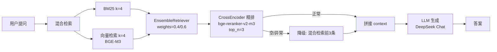

# Enterprise Knowledge Base v1

一个本地可运行的企业知识库 RAG 系统：**BM25 + 向量混合检索 → CrossEncoder 精排 → LLM 生成**，支持 Chroma 持久化与增量入库，带检索降级与调试输出。

> 定位：单机验证版的 RAG 闭环，聚焦「检索链路完整 + 可降级 + 可调试」。生产化能力（修改/删除同步、引用校验、异步服务化）见 [Roadmap](#roadmap)。

---

## ✨ 特性

- **混合检索**：BM25（关键词）+ BGE-M3 向量（语义），`EnsembleRetriever` 融合，权重可配
- **CrossEncoder 精排**：`BAAI/bge-reranker-v2-m3` 对混合召回结果重排序，`top_n=3`
- **检索降级**：精排空结果 / 精排异常时自动退回混合检索，链路不中断
- **增量入库**：基于内容 MD5 指纹去重，重复导入幂等
- **Chroma 持久化**：本地落盘，重启不丢索引
- **空检索兜底**：无检索结果时不调用 LLM，避免幻觉
- **分层调试**：`DEBUG` 开关可打印 BM25 / 向量 / 混合 / 精排四层召回结果

---

## 🏗 架构



**检索分层**：BM25 负责专有名词与关键词精确匹配（如 `Art_1062`），向量负责语义匹配（如「持久化」→ `SqliteSaver`），精排负责在候选池里挑出最相关的 3 条送进 LLM。

---

## 🚀 快速开始

### 1. 环境要求

- Python 3.10+
- 可访问外网（首次运行会下载 `bge-m3` 嵌入与 `bge-reranker-v2-m3` 精排模型）

### 2. 安装依赖

```bash
pip install langchain-chroma chromadb langchain-openai langchain-community \
            langchain-classic rank_bm25 sentence-transformers python-dotenv
```

> `langchain-classic` 提供 `EnsembleRetriever`、`ContextualCompressionRetriever`、`CrossEncoderReranker` 等检索组件。若你的环境中这些模块位于其他包名下，按实际导入路径调整即可。

### 3. 配置环境变量

在项目**父目录**创建 `.env`（代码中按 `../.env` 加载）：

```dotenv
DEEPSEEK_API_KEY=sk-xxxxxxxxxxxxxxxx
SILICONFLOW_API_KEY=sk-xxxxxxxxxxxxxxxx
```

| 变量 | 用途 | 获取方式 |
|---|---|---|
| `DEEPSEEK_API_KEY` | LLM 生成（`deepseek-chat`） | [DeepSeek 开放平台](https://platform.deepseek.com/) |
| `SILICONFLOW_API_KEY` | Embedding（`BAAI/bge-m3`） | [SiliconFlow](https://siliconflow.cn/) |

> 代码中已设置 `HF_ENDPOINT=https://hf-mirror.com` 加速 HuggingFace 模型下载，国内网络环境下无需额外配置。

### 4. 运行

```bash
python enterprise_kb_v1.py
```

首次运行会：
1. 初始化 Chroma（`./enterprise_kb_db`）
2. 对 6 条样本文档切分并入库
3. 执行两组测试问答

再次运行同一批数据会显示 `🔄 数据无变化，跳过入库。`

---

## 📁 项目结构

```
.
├── enterprise_kb_v1.py      # 主流程：初始化 → 入库 → 检索 → 生成
├── rag_utils.py             # 工具：文档指纹、清洗与切分
├── enterprise_kb_db/        # Chroma 持久化目录（运行后生成）
└── .gitignore
└── requirements.txt
└── README.md
```

**`rag_utils.py`**

| 函数 | 作用 |
|---|---|
| `generate_doc_id(content)` | 基于内容 MD5 生成文档唯一指纹，用于增量去重 |
| `clean_and_split_documents(docs)` | 统一 metadata（`source_system`、`author`）+ 中文优化递归切分（512/50） |

---

## ⚙️ 核心参数

集中在 `enterprise_kb_v1.py` 顶部，便于调参：

| 参数 | 当前值 | 说明 |
|---|---|---|
| `HYBRID_WEIGHTS` | `[0.4, 0.6]` | BM25 / 向量融合权重 |
| BM25 `k` | `4` | 关键词路召回量 |
| 向量 `k` | `4` | 语义路召回量 |
| 精排 `top_n` | `3` | 精排后送入 LLM 的文档数 |
| `DEBUG` | `False` | 是否打印四层召回调试信息 |
| `chunk_size` / `chunk_overlap` | `512` / `50` | 切分粒度 |

---

## 🧪 使用示例

### 正常问答

```python
ask_enterprise("生产环境怎么持久化？")
ask_enterprise("Art_1062 的功率是多少？")
```

输出：

```
🙋‍♂️ 用户: 生产环境怎么持久化？
🤖 专家: 根据现有资料，生产环境推荐使用 SqliteSaver 或 PostgresSaver 进行持久化。
```

### 调试召回链路

将 `DEBUG` 改为 `True` 后运行，会打印每一层召回的文档片段：

```
--- [DEBUG] 生产环境怎么持久化？
BM25 : ['食堂本周菜单以川菜为主...', '公司年会定于 12 月 20 日...', ...]
向量 : ['LangGraph 的 Checkpointer', '生产环境推荐使用 SqliteSaver 或 P', ...]
混合 : ['公司年会定于 12 月 20 日...', 'Python 3.12 引入了新的...', ...]
精排 : ['生产环境推荐使用 SqliteSaver 或 P', 'LangGraph 的 Checkpointer', ...]
```

用于定位问题出在「召回阶段」还是「精排/生成阶段」。

### 增删改

- **新增**：直接改 `raw_docs` 后重新运行，只会入库新内容
- **修改/删除**：⚠️ 当前版本**不支持**，详见 [已知限制](#已知限制)

---

## ⚠️ 已知限制

当前为 v1 验证版，以下能力**尚未实现**，属于已知边界：

1. **修改/删除会留脏数据**  
   主键是内容 MD5，内容一变就变成"新增"，旧块永久残留。文档删除后旧块仍会参与检索。

2. **答案无引用编号**  
   Prompt 未要求 LLM 标注来源，无法判断答案具体用了 context 中哪几条，生成层可观测性不足。

3. **BM25 每次启动全量重建**  
   `rank_bm25` 无增量 API，启动时从 Chroma 全量拉取重建，数据量大后冷启动变慢。

4. **全同步调用**  
   检索与生成均为同步阻塞，未提供异步/流式接口，面向服务化时需改造。

5. **`debug_retrieve` 与 `ask_enterprise` 各检索一次**  
   开启 DEBUG 时同一 query 会跑两遍精排，日志与实际答案非同一次调用结果。

---

## 🗺 Roadmap

- [ ] **数据治理**：引入 `source_id`，支持按源文档"先删后加"，覆盖修改/删除场景
- [ ] **生成可观测**：context 带 `[编号]`，Prompt 要求引用标注，用于人工核验与忠实度评估
- [ ] **检索评估**：构建 Golden Set + `recall@K` 回归测试，量化每次调参收益
- [ ] **查询改写**：MultiQuery / HyDE，缓解 query 与文档表述形态差异
- [ ] **父子索引**：小块检索、大块生成，兼顾精度与上下文完整性
- [ ] **BM25 优化**：缓存 tokenized corpus，或换用支持持久化/增量索引的全文引擎
- [ ] **异步与流式**：`ainvoke` / `astream`，降低服务化首字延迟
- [ ] **幻觉防护**：答案关键实体与 context 做校验，不通过时降级拒答

---

## 🧰 技术栈

| 组件 | 选型 |
|---|---|
| LLM | DeepSeek `deepseek-chat` |
| Embedding | `BAAI/bge-m3`（via SiliconFlow） |
| 精排模型 | `BAAI/bge-reranker-v2-m3`（CrossEncoder） |
| 向量库 | Chroma（本地持久化） |
| 关键词检索 | `rank_bm25` |
| 编排框架 | LangChain（Runnable / Retriever / Ensemble） |

---

## 📄 License

MIT（如用于学习或二次开发，请按需调整）